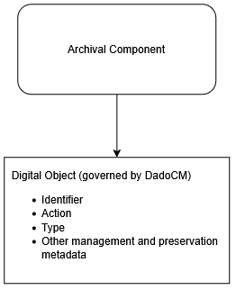
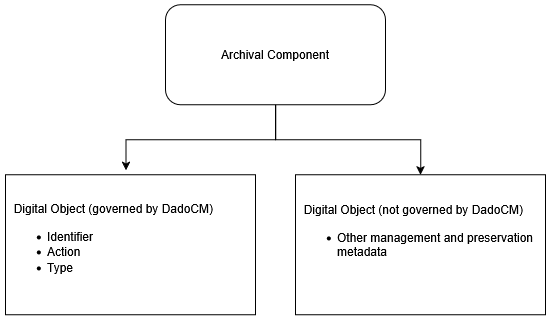
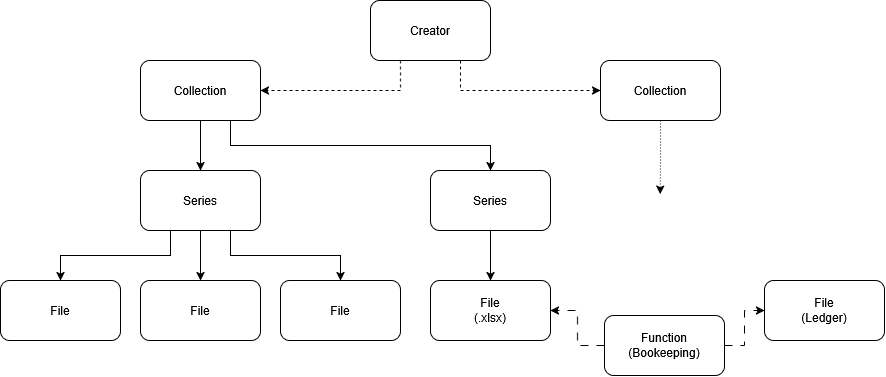
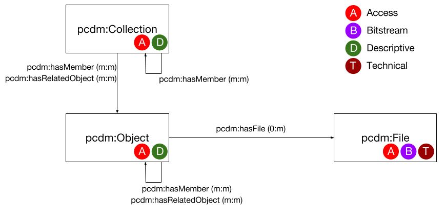
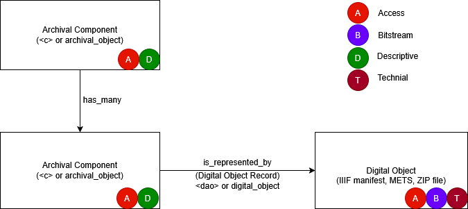

# Delivering Archives and Digital Objects: a Conceptual Model (DadoCM)

## **Contributors**

Brenda J. Foster  
Caitlin Goodman  
Elena Colón-Marrero  
Elizabeth Russey Roke  
Gregory Wiedeman  
Jennifer Palmentiero  
Maureen Cresci Callahan  
maría a. matienzo  
Mark Wolfe  
Meghan Slaff  
Nikolas Lamarre  
Shelly Black

We would also like to thank our remote cohort participants for their thoughtful discussions, critical insights, and diverse perspectives, which helped shape this effort:

Anna Goslen, Elvia Arroyo-Ramirez, Evian Yiyun Pan, Hannah Sistrunk, Jessica Farrell, Jodi Allison-Bunnell, kYmberly Keeton, Linda Hocking, Margaret Peachy, Megan Mummey, Sarah Newhouse, Zach Johnson

## **Section 1\. Introduction**

Archivists have long been hindered in their work with digital materials because existing digital repositories are designed primarily for managing discrete digital objects, not for providing bulk access following archival principles. These systems assume that every digital object requires an individual, detailed metadata record—an approach that does not scale for large collections, where materials are more efficiently described in groups or aggregations. As a result, archivists must duplicate labor, often painstakingly re-describing materials that have existing metadata, diverting time and resources away from enabling rapid access. Users, in turn, face fragmented discovery experiences, navigating separate systems for archival description and digital content.

Archival principles and best practices offer important advantages for addressing the persistent challenge of managing and providing access to large volumes of digital materials. While archivists excel at organizing and contextualizing vast collections of physical records, system limitations prevent them from applying these same methods to digital content. This model aims to leverage the enormous inherent opportunities in archival description to provide better, speedier, more intellectually rigorous, and far less costly access to digital materials.

Delivering Archives and Digital Objects: a Conceptual Model (DadoCM) addresses this challenge by providing a minimal, system-agnostic framework that integrates digital and physical collections within a single user interface designed to leverage archival methods. This allows archivists to rapidly make digital materials available by leveraging standards such as the International Image Interoperability Framework (IIIF) to provide bulk access to large groupings or aggregations of materials at the point where they are comprehensible or navigable by users.

By leveraging existing archival description, DadoCM frees archivists from writing hundreds of item-level records for born-digital or individually digitized objects that have already been sufficiently described. Instead of requiring users to navigate separate systems, DadoCM enables them to discover and access physical and digital archival materials together.

DadoCM does not dictate storage methods, specific software, or metadata structures beyond what is essential for access. Instead, it incorporates digital objects into archival description by identifying essential metadata elements to address four fundamental questions:

* Where can digital objects be found? (Identifier or location)  
* What are these objects? (Their nature and characteristics)  
* How should they be rendered for delivery? (Appropriate system behaviors)  
* Why might they not be accessible? (Access conditions or restrictions)

These elements ensure that access systems can locate, interpret, and present digital objects while clearly indicating access restrictions and offering limited or alternative content when appropriate.

By emphasizing the separation of archival description from digital object management, DadoCM supports well-structured data practices that support maintainability while ensuring interoperability with archival systems and practices. This approach allows institutions to integrate DadoCM into their workflows—whether using traditional databases, spreadsheets, file systems, or other data management tools. Designed with minimal computing approaches in mind, DadoCM remains practical to implement and accessible to a wide range of implementers.

DadoCM serves as an effective communication tool between archival practitioners, technologists designing and maintaining archival systems, and administrators seeking practical process improvements. It provides both the theoretical foundation and concrete guidance necessary to implement DadoCM effectively in various environments.

Finally, DadoCM envisions new designs for archival access systems that integrate metadata from both archival components and digital objects—often managed in separate systems—into a single user interface that facilitates discovery using archival description and delivers digital objects within that context. By promoting shared understanding and common practices in this work, DadoCM aims to facilitate new designs that create new discovery and access paths for users.

### Focus on Access over Management and Preservation

Archivists currently use digital object records in systems like ArchivesSpace for both fulfilling access to digital content and for managing digital content in long-term storage, including managing digital preservation information. For example, an institution may create a digital object record that stores the identifier used to retrieve a preservation package from long-term storage. The DadoCM conceptual model focuses on facilitating access – it is not concerned with the management or preservation of digital objects. Management concerns often need to be more local and customized, and thus flexible.

DadoCM only addresses how digital content is represented and made available through archival discovery and access systems. Because this access relationship is the same whether content is digitized or born-digital, DadoCM applies equally to both. Repositories may choose to maintain preservation metadata, package identifiers, storage locations, fixity information, and other management data within the same digital object record that expresses DadoCM access information, or in separate but related records linked to the same archival component. These implementation decisions are outside the scope of DadoCM.

For example, a repository might use a single digital object record to represent both access and preservation information, while another repository might maintain separate digital object records linked to the same archival component, one focused on access and another focused on preservation and content management. In either case, the records may represent the same archival component while serving different purposes.

Once archivists have stronger pathways for delivering digital objects through archival description, practices for digital content management and preservation may evolve in ways that align with this conceptual model. Preservation and management workflows, however, remain local implementation concerns outside the scope of DadoCM.

#### Diagram 0

<figure id="diagram-0-access_management" aria-labelledby="diagram-0-caption">
  

    
  
  

  <figcaption id="diagram-0-caption">
    <strong>Diagram 1.</strong> Different options for management and preservation of digital objects alongside DadoCM
  </figcaption>
</figure>

## **Section 2\. Definitions**

**Aggregate or Aggregation:** a meaningful grouping of materials as defined by an archivist based on natural relationships among records that preserves their functional and administrative context. This could be any grouping that is useful for users.

**Archival Component:** a node within a graph of archival description that describes an aggregate of materials, such as a collection, fonds, record group, series, subseries, or file. Examples include an archival object or resource record in ArchivesSpace or a **`<c>`**, **`<c01>`**, **`<c02>`**, etc. element in Encoded Archival Description (EAD).

**Digital Object:** A manifestation or instance of an archival component that should include any structural metadata necessary to consume the object. Since an archival component is an aggregate, this could be anything from a single JPG file or a complex multi-level file system, or just a grouping of materials in different formats. Archival methods expect descriptive metadata and information on context and provenance to be primarily managed outside of a digital object, yet digital objects may contain descriptive metadata for legacy and technical reasons. Within DadoCM, a digital object is a conceptual entity rather than a specific implementation.

**Digital Object Record:** A metadata record that connects an archival component to its digital object so that the digital object may be delivered to the user. In most implementations, a digital object record exists as a separate record linked to an archival component. However, because a digital object is a manifestation of an archival component, simpler implementations could instead store equivalent information directly within the archival component itself. For example, ArchivesSpace implements digital object records as separate digital_object records linked to archival components, while EAD 2002 may represent similar information through a single **`<dao>`** element which could be collapsed into a **`<c>`** component as attributes in a very basic implementation. DadoCM defines the information required to maintain this relationship without prescribing how it must be implemented or how one should use digital object records.

## **Section 3\. Core Principles**

### 1. Archival description is structured as a graph of related components

Archival description has traditionally been presented in a hierarchical tree structure of related parent, sibling, and child elements, like collections, series, files, and items. A graph structure keeps this hierarchy but adds another dimension, where additional access points, such as creator agents or common forms are also connected. Users can not only navigate between components like from a series to a file, but from a component to a creator agent to another component, potentially within another collection or housed at another repository. This structure draws on linked data approaches and prior work such as the [Records in Contexts Conceptual Model (RiC-CM)](https://www.ica.org/ica-network/expert-groups/egad/records-in-contexts-conceptual-model/), but DadoCM does not require or necessarily expect implementations to support linked data, and linked data is not the only method of implementing these relationships.

#### Diagram 0

<figure id="diagram-0" aria-labelledby="diagram-0-caption">
  

  <figcaption id="diagram-0-caption">
    <strong>Diagram 1.</strong> A example of the graph structure of archival description
  </figcaption>
</figure>

### 2. Disambiguating and Deduplicating Archival Components and Digital Objects

With the advent of technologies like IIIF, it is possible for the archival description in finding aids to be connected to digital assets *without* duplication of information and labor across systems. For many practitioners, this is a paradigm shift. We encourage archivists and the stewards of archival access system to take seriously two core ideas:

1. Archival materials exist as nodes within a network \-- items, files, series, record groups, and other groupings within an archival collection. Core archival theory principles are unambiguous \-- archivists must explain and make explicit the relationships between the parts and the whole of an archival collection. **The meaning of an individual record becomes impoverished when it is removed from its context.**  
2. System design principles encourage [orthogonality](https://en.wikipedia.org/wiki/Orthogonality_\(programming\)), which calls for related data to be updated and maintained independently. We must ensure that information has a clearly defined, authoritative source and avoid maintaining the same information in multiple places. **Information may be displayed in multiple places, but it must only be created and updated in one, canonical system of record.**

### 3. Digital Objects are Manifestations of Archival Components

A Digital Object shall fully represent an Archival Component in a one-to-one relationship. The archival component is the unit of description, while the digital object is the manifestation of that description in digital form. Consequently, digital objects should not be created to describe or represent only a portion of an archival component. If part of an archival component requires separate description or intellectual identification, archivists should create a sub archival component (such as an item within a file) and associate a digital object with that component. This ensures that descriptive metadata remains within the archival hierarchy and that digital objects continue to function as manifestations of archival components rather than becoming parallel descriptive records.

Yet, since archival components can be aggregates, digital objects can be a manifestation of that same grouping, meaning they can contain multiple things as long as the scope of the digital object is the same as the archival component. For example, an archival component can describe an aggregate or grouping of multiple different files, and its digital object is a grouping of those things in a IIIF manifest, a ZIP file, or just a PDF.

This sets a clear distinction between the archival component, which carries descriptive metadata, and the digital object which is concerned with the technical challenges of structuring and delivering digital content. This simplicity also supports usability by allowing an archival component, digital object record, and digital object to be easily collapsed into one view for users.

Using the [Portland Common Data Model (PCDM)](https://pcdm.org/) for comparison. While Digital Asset Management Systems (DAMS) consider a “digital object” as descriptive record, DadoCM envisions archival components to take that role, thus maintaining its descriptive archival context. DadoCM instead envisions digital object as manifestations of that component, and should only carry the content, access and technical information.

#### Diagram 1

<figure id="diagram-0" aria-labelledby="diagram-0-caption">
  

  

  <figcaption id="diagram-0-caption">
    <strong>Diagram 1.</strong> A comparison of the high-level structure of DadoCM with the Portland Common Data Model (PCDM)
  </figcaption>
</figure>

### 4. Maintain Persistent Links Between Digital Objects and Archival Description

While digital objects are often managed and maintained separately from archival description, they still must be made available to users within their archival context. To achieve this, archivists need to maintain persistent connections between digital objects and the archival components that describe them.

Digital objects should not exist independently of their archival context. **Every digital object must maintain a persistent connection to the archival component that describes it.** We can do this through the inclusion of the archival component’s unique identifier \[see [Diagram 2](#diagram-2)\]. This could be a URI, a primary key in a database, a Universally Unique Identifier (UUID), an accession number, a catalog number, or similar. This inclusion provides contextual information to the digital object, especially in environments where a digital object is separated from its archival description. The digital object should not exist on its own – there should always be a connection back to the archival component.

ArchivesSpace implements this automatically for us if we ensure our digital objects are connected to an archival component. ArchivesSpace then exposes this relationship through its Public User Interface (PUI), its REST API, or through \<dao\> tags in EAD exports.

#### Diagram 2 {#diagram-2}

<figure id="diagram-2" aria-labelledby="diagram-2-caption">
  

  <figcaption id="diagram-2-caption">
    <strong>Diagram 2.</strong> A system-agnostic diagram showing an archival component linked to a digital object record through a shared unique identifier.
  </figcaption>
</figure>

### 5. Describe and provide access to aggregations of digital materials at the point where they are self-describing

Digital objects are often aggregations of digital materials. Aggregation is fundamental to archival description, enabling archivists to efficiently manage vast volumes of material without unnecessary effort. For instance, we may describe a file of correspondence between two organizations that has specific access restrictions without itemizing each memorandum and restating those restrictions. In the context of digital materials, a group of records may have sufficient organization that does not merit further description. Similarly, from the standpoint of complex digital objects, they are likely best understood as aggregations themselves. Examples include:

* a digitized scrapbook of 32 pages, each with a single digital image  
* a born-digital legal agreement consisting of 3 different PDFs but managed as a single digital object in a repository  
* a two-part oral history interview accessible from a single directory on a web server  
* an electronic records transfer with an extensive directory structure and a variety of binary files.

Archivists should use their professional judgement to determine when it is appropriate, feasible and meaningful to scope a digital object at a large aggregate level or at more detailed levels, and archival systems must support these choices. Following aggregate description principles, archivists may create more detailed description for digital objects when doing so supports meaningful user access and discovery. Such professional judgement must be exercised holistically, balancing user needs, available resources, and the stewardship requirements of the entirety of their holdings.[^1]

DadoCM is intended to support these choices and enable archivists to leverage aggregation. As such, it does not provide a mechanism for modeling complex digital objects on its own. Many standards exist for this, covering various use cases, with the International Image Interoperability Framework (IIIF) being a widely adopted and effective method for managing aggregates of digital material along with metadata and exposing them for interoperable use. Metadata Encoding and Transmission Standard (METS) is another method and many repositories have long used PDF files to aggregate digital objects in a single file.

### 6. IIIF Manifests as Digital Objects

While DadoCM is system-agnostic, it strongly recommends using IIIF manifests to structure and provide access to digital objects whenever feasible. IIIF manifests are a proven way to deliver structured aggregations of digital materials in the form of digital objects. They contain content, metadata, alternative representations, and the internal relationships that allow us to navigate and make use of complex digital objects. While most repositories struggle to implement and maintain additional technology, since IIIF has been widely adopted, [check to see if your existing systems support IIIF](https://iiif.io/get-started/vendors/).

IIIF can meet many of our common needs for delivering aggregate digital objects. IIIF manifests support textual representations such as transcripts or captions and other supplementary content such as multiple representations of the same content. Archival access systems can leverage textual representations within manifests to support full-text search of digital objects alongside archival description.

The widespread support of IIIF across many types of DAMS and other digital repositories also provides archives access systems with a single point of interoperability. By reading IIIF manifests linked from archival description, systems can work with a wide variety of systems and implementations.

Overall, IIIF manifests allow archivists to provide aggregations of self-describing digital objects, such as pages of a book, items in a folder, or potentially even multi-level hierarchical objects. However, there are notable gaps in both image viewers’ limited support for navigating nested collections and for the delivery of arbitrary content outside of images, audio, or video, discussed in [Section 8](#iiif-image-viewers). [Diagram 3](#diagram-3) below illustrates connections between IIIF manifests, digital object records, and archival components.

While IIIF does not address every possible digital object use case, DadoCM is primarily concerned with supporting common archival access needs rather than edge cases. Archivists should continue to exercise professional judgment when selecting the most appropriate delivery mechanism for digital content. In some cases, IIIF manifests may provide the best solution; in others, direct file delivery, ZIP packages, streaming services, or other approaches may be more appropriate. DadoCM primarily seeks to clarify the distinction between descriptive concerns and delivery concerns. IIIF manifests are a particularly valuable example because they package content, metadata, structural relationships, and alternative representations in a way that promotes interoperability across systems and allows archivists to deliver materials in aggregate.

#### Diagram 3

<figure>
  
  <figcaption>
    <strong>Diagram 3.</strong> Example of a digital object record linking an archival component to a IIIF manifest.
  </figcaption>
</figure>

## **Section 4\. Perspective and Prospective**

### The Challenge of Segregated Systems

Archivists begin their work by describing a collection as a whole: its provenance, its scope, and rules around how (and whether) users can access it. Within that whole, archivists are very good at determining meaningful and sufficient aggregations to encourage discovery and access, without burying the user with irrelevant information. Archival description systems, like finding aids and ArchivesSpace, are currently segregated from digital discovery, whether that discovery is in DAMS or other repositories. This division in systems means archivists cannot use the strength of established descriptive practices to describe large volumes of digital objects.

Separate systems also pose challenges for user experience and discovery. Users struggle to find related materials across multiple systems that employ different descriptive methods and standards. If our data can cross the boundaries of these systems in consistent, thoughtful, and interoperable ways, we can build and sustain new interfaces for this data that provides the ability to search and discover digital objects within the context of collection-based archival description.

The graph-based structure of archival description—reflecting a network of archival components and their relationships traditionally thought of as a hierarchy—is poorly modeled in DAMS and other digital repositories. While efforts have been made to represent archival data within Samvera and Islandora environments, developing usable interfaces for navigation and display of the archival graph or hierarchy is challenging. Additionally, the digital object management functionality of DAMS imposes substantial complexity that further complicates archives systems. Following the separation of concerns principle, archival access systems should be designed specifically for discovery and navigation of archival data, while digital repositories should focus on managing digital objects. This distinction ensures that each system can be optimized for its respective function without compromising usability. What is missing in our current systems environment is the capability for archival systems to fully incorporate digital object discovery. This can be done without requiring archival systems to manage aspects like storage and preservation for our digital content.

### Advantages of archival description for labor and resources

Archival description, with its aggregate approach, is much more labor efficient than describing digital materials one-by-one in Metadata Object Description Schema (MODS) or DublinCore records. Completing the same descriptive fields for each digital object often requires a lot of duplication, as a collection of photographs each are likely to have the photographer listed in a creator field. Chances are there is other information that applies to the whole collection or large portions of it that would have to be duplicated for each item. The archivist’s approach describes the collection as a whole, and then empowers the archivists to use their labor thoughtfully to describe smaller units to meet user needs.

Using archival description for digitization also means we can use the existing description created by archivists during processing instead of creating new individual metadata records for each item. Since no new metadata records are needed, this lowers labor costs to where it is feasible to reformat more types of materials on user request as part of regular activities.

DAMS and other digital repositories are complex systems with high implementation and maintenance costs. By enabling archival access systems to consume digital object data from external sources, DadoCM gives implementers more flexibility in defining the role of a DAMS. This could allow for backend-focused DAMS implementations or other solutions that do not require a public-facing interface, providing more choices and lowering the barrier for certain use cases.

### Advantages for Users and the User Experience

The DadoCM benefits the user by providing a clearer understanding of the origin of digital objects within its broader archival context. Because archival materials come in collections—typically created or maintained by the same person or organization and bound by a set of promises to their provider—it is a long-standing and essential practice to keep these materials together administratively. This ensures that their original relationships remain intact, helping researchers uncover meaningful connections.

By linking archival and digital objects, DadoCM preserves these relationships, allowing users to navigate between related materials and trace them back to their original record. Just as archivists describe records in meaningful aggregates—such as collections, series, or files—DadoCM maintains this structure, making it easier for researchers to discover additional relevant materials that might otherwise go unnoticed.

Various user studies, including Coup (2021) have demonstrated that archivists’ use of inherited description \-- providing a graph of related nodes where relationships are meaningful and context is clear \-- are an extremely effective technology.[^2] Users almost always successfully find what they are looking for. Coup found that users are indeed *more* successful when description is provided in aggregate with contextual information than when many individual, more-granular descriptions are provided.

The integration of archival and digital object data with DadoCM opens new possibilities for experimentation. Traditional paper finding aids envisioned a top-down approach, guiding users from collections down to individual items. However, DadoCM enables access systems to leverage archival description in more dynamic ways. By indexing data at multiple levels, discovery is no longer restricted to a hierarchical path—it can also be lateral or bottom-up, allowing users to find individual items through descriptions indexed from higher levels in the archival graph.

DadoCM also makes it more feasible to build a single purposefully designed interface with one search box and one navigation system. Allowing users to interact with a single system mirrors the experience of a physical reading room, where researchers explore materials in context rather than being directed to isolated items. By allowing systems to leverage the natural structure of archival collections, DadoCM enhances both navigation and serendipitous discovery, enabling users to uncover richer insights about the past.

## **Section 5\. Delivering Archives and Digital Objects: A Conceptual Model (DadoCM)**

DadoCM defines a minimal yet robust conceptual model for associating archival components with digital objects in user-facing access systems. Its primary objective is to facilitate the structured discovery and delivery of digital materials while preserving the hierarchical and contextual relationships inherent in archival description.

Archival collections are structured into a graph of related components (e.g., collections, series, files) that may have both physical and digital representations. Within this structure, digital objects are defined as discrete digital manifestations or instances of archival materials, distinct from the intellectual content they embody. This includes:

* Digitized materials (e.g., a scanned letter or photograph from a file folder)  
* Born-digital materials (e.g., an email folder or a digital photograph)

To ensure effective access within archival description, digital objects do not require descriptive metadata beyond their link to an archival component. However, they do require essential metadata to support its delivery within an archival access system, including:

* **Identifier/Location:** A stable reference to the digital object (e.g., a URI)  
* **Type and Characteristics:** Information about the object's format and nature (e.g., image, text, audiovisual)  
* **Rendering and Delivery:** Guidance on how the object should be presented in user interfaces  
* **Access Conditions:** Constraints that affect availability, including access restrictions and limitations

As a conceptual model, DadoCM is merely a common understanding of the data needed by the archival access systems to provide discovery and access to digital objects within archival description in a single interface. DadoCM facilitates storing data wherever it makes the most sense for local needs. Rather than expecting all fields to be stored in a single digital object record, it encourages implementers to use well-defined systems of record that minimize duplication and ensure effective data management.

### Scope

The purpose of this specification is to facilitate the delivery of digital objects within archival description, ensuring they can be accessed and fulfilled online.

DadoCM is not designed to comprehensively model digital objects themselves, as they are better structured and expressed through formats such as IIIF manifests or other structural standards such as PCDM. Likewise, this conceptual model does not address rights management, long-term digital preservation, or the creation of detailed descriptive metadata for search engine indexing, as these needs are more effectively handled by a constellation of existing standards.

### Semantic Unit list

| Semantic Unit | Required or Optional |
| :---- | :---- |
| Archival Component Relator | Required |
| Identifier  | Required |
| Identifier label | *Optional* |
| Action | Required |
| Type | Required |
| Conditions Governing Access | Required |
| Representative Sample | *Optional* |

#### Archival component relator (required)

The identifier of the archival component to which the digital object is related. This could be a URI or Universally Unique Identifier (UUID) created by a tool such as ArchivesSpace.

#### Identifier (required)

An identifier representing the digital object.  Each digital object may have only one identifier.

Implementers may consider using the Archival component relator as the identifier or if a separate digital object identifier is necessary. For example, an ArchivesSpace URI or ref\_id for an archival component could also serve as the digital object identifier.

#### Identifier label (optional)

A name for the digital object. May be the title of the archival component the Digital Object is linked to or some descriptive label. This is useful for “link” actions that need human readable text for a link.

#### Action (required)

Indicates the desired rendering action for the digital object. Recommended practice is to use a controlled vocabulary.

##### Example vocabulary:

* embed  
* link  
* none

#### Type (required)

Identification of the general type of resource represented by the linked digital object. This value is primarily intended to support access and delivery by indicating what viewer, renderer, or access mechanism should be used. It is not necessarily intended to describe all files or formats represented by the archival component. For example, a single archival component may contain many file formats, yet be delivered through a single IIIF manifest or collection resource. Type typically informs what tool or method should be used for “embed” or other type specific rendering actions.

For complex digital objects, the Type value may describe the delivery resource rather than the underlying files. For example, a directory containing images, video, and text documents may be represented and delivered through a IIIF Collection, IIIF Manifest, or ZIP file, in which case the Type would identify the IIIF resource or ZIP rather than each individual file format.

The use of a controlled vocabulary such as the [DCMI Type Vocabulary](https://www.dublincore.org/specifications/dublin-core/dcmi-terms/#section-7) or standard MIME types is strongly recommended for this element. DCMI Types offer a simpler range of types for access systems to implement while MIME types offer more precision. Implementations may also use locally defined controlled values when necessary to support specific delivery mechanisms.

For IIIF manifests, it is recommended to use the [DCMI Type Collection](http://purl.org/dc/dcmitype/Collection) or if using MIME types, to specify them as JSON-LD documents and to use additional profiling to include the specific IIIF context URL. For example, the MIME type for a IIIF v3 Presentation API manifest would be:  
`application/ld+json; profile="http://iiif.io/api/presentation/3/context.json"`.

#### Conditions Governing Access (required)

Information about any restrictions or conditions to accessing the digital object. Use of a controlled vocabulary or URI is required.

Archival description rules such as in [DACS](https://saa-ts-dacs.github.io/) and [ISAD(G)](https://www.ica.org/resource/isadg-general-international-standard-archival-description-second-edition/) provide guidance to help us explain to users whether \-- and how \-- they can access archival materials. These rules apply equally to physical materials on the stacks and digital objects in our systems. It is always important to explain to users at the most relevant level of aggregation what is available to them and what barriers they may encounter to access.

Access conditions may be defined at any level of archival description and inherited by subordinate archival components. **DadoCM does not require access conditions to be repeated for every digital object. However, the effective access conditions that apply to a digital object must be available in a machine-actionable form so that access systems can communicate, filter, and enforce those conditions.**

Ideally, machine-actionable access information would be managed alongside archival description and inherit through the archival hierarchy in the same manner as human-readable Conditions Governing Access notes. However, because access conditions have traditionally been recorded only as narrative text, implementations may need to store, derive, or duplicate equivalent access information for digital object delivery. DadoCM does not prescribe where this information is stored. Rather, it requires that the access conditions applicable to a digital object be available in a machine-actionable form when the digital object is delivered to users.

In this conceptual model, Conditions Governing Access notes and machine-actionable access rules are semantically equivalent. Information about access conditions must be tied to the digital object in a machine-actionable way so that systems have the information they need to actualize the terms of these conditions. This machine-actionable information about access should be provided via a URI or controlled vocabulary. 

Implementers may need to store multiple representations of Conditions Governing Access notes for human and machine use or translate the text of the conditions governing access note to a machine-actionable field so that the fulfillment system will know whether to allow access. This will also make it possible for descriptive systems to filter by access conditions.

In all cases, the information we give to humans in conditions governing access notes and the information we give to systems about the terms of access (IP restriction, log-in requirement, etc.) must be aligned and consistent.

#### Representative sample (optional)

A stand-in or representative content for the digital object for usability or for digital objects with limited access. This could be a thumbnail URL or an audio or video clip. Must be a retrievable URI.

### Table of fields with examples

| Semantic Unit | Required or Optional | Examples |
| :---- | :---- | :---- |
| **Archival Component Relator** | Required | /repositories/2/archival\_objects/26805 21bee7e46eda3f8ae11f01f344c11f0a 5f4cc70b-44f0-4a99-a50d-96a0b8ce14e5 |
| **Identifier**  | Required | 26805 21bee7e46eda3f8ae11f01f344c11f0a w3763s750 |
| **Identifier label** | *Optional* | Link to content Online access |
| **Action** | Required | embed link none |
| **Type** | Required | image/jpeg application/pdf application/warc application/wacz application/ld+json; profile="http://iiif.io/api/presentation/3/context.json http://purl.org/dc/dcmitype/Collection http://purl.org/dc/dcmitype/StillImage http://purl.org/dc/dcmitype/Sound |
| **Conditions Governing Access** | Required | https://vocab.example.org/access/open https://vocab.example.org/access/login https://vocab.example.org/access/closed http://iiif.io/api/auth/1/login |
| **Representative Sample** | *Optional* | https://my.server.org/do/pk02cv45j/thumbnail.jpg |

## **Section 6: Legacy Concerns**

DadoCM represents a significant shift in practice and strict adherence may be aspirational for many repositories in the short term. Most repositories have decades of existing systems, metadata, workflows, and digitized content that cannot realistically be restructured all at once. Archivists should work toward greater alignment with DadoCM as they maintain systems and metadata over time. Existing metadata should be updated when doing so provides clear benefits to users, and implementations may include a mixture of legacy and DadoCM-aligned practices while continuing to provide access to existing digital content.

Yet, archivists should prioritize immediate choices that allow for long-term alignment, like including archival component identifiers in digital object records so these connections will not be lost. and archvists should handling digital material moving forward in alignment with DadoCM. Archivists should follow archival descriptive principles that tell us very clearly that our archival descriptions must fully describe the scope of the aggregation made available to the researcher. The corollary to this is that when part of a finding aid describes a body of records (an item, file, group of recordings, reel of film), the finding aid should then point to the *totality* of the materials described. In other words, there should be a one-to-one relationship between the archival description and the items represented in a digital object.

This model provides a new, much less resource-intensive way of providing access to digital materials using archival description. By reusing archival description as the primary source of descriptive metadata and limiting the information required to connect descriptions and digital objects, DadoCM reduces metadata duplication, simplifies workflows, and lowers long-term maintenance costs. The simplicity and standardization promoted by DadoCM should also enable more cost-effective development of repository and access tools. By establishing a common pattern for connecting archival descriptions and digital objects, institutions can share implementations, reduce customization, and focus resources on improving access and functionality rather than repeatedly solving the same integration problems.

### Coverage: The Part of A Component Problem

This may be a departure from current practices in many repositories. In a situation where a researcher requests a handful of photographs to be digitized from an entire envelope of photographs (described in a single archival component as “Mardi Gras 1988,” having a total of 36 snapshots in the envelope, for instance), it may have been the practice to only scan the four photos requested, and then email them to the researcher or describe them individually in a digital library system. In this new model, we encourage archivists to go ahead and digitize all 36 images for sustainable long-term access \-- and to store them all together, associated with the existing description of “Mardi Gras 1988,” and linked from the finding aid. While the archivist is always empowered to extend the finding aid to add lower, item-level descriptions of each photograph to avoid digitizing all images if the situation warrants it, typically no additional description is necessary since the images in this example were successfully found and requested. In cases where digitizing the entire archival component is not feasible, the archivist can still digitize portions of the component to enable immediate use without making these scans available for future use.

While this practice risks increasing data volumes and exacerbating emissions that contribute to climate change, increases should be marginal and the additional data is necessary to ensure it is manageable to maintain digitized materials for ongoing use. Archivists should also make informed judgements that weigh the advantages of access, the value of the material, and the total costs of ongoing maintenance when choosing to digitize an entire component for long term use or just a portion for short-term access.

It is important to be able to serve researchers the enormous body of materials that have already been digitized and described, where this model may not have been used. In some cases, our digital library systems may just have a portion of many archival components. For the purposes of accommodating legacy assets, it is possible, in this case, to associate the four digitized photos with the component that describes 36 photos. In this case, it is important to note the description of the archival component that the digital object’s coverage is only part of what is being described, such as not using the ArchivesSpace “Make Representative” feature.

### Handling Multiple Digital Objects Per Component

### Existing Digital Object Level Descriptive Metadata

This section provides recommendations on how to make productive use of legacy digital object metadata in archival systems. While duplication of descriptive metadata at the digital object level is often an unnecessary and time-consuming process, most archival repositories have existing item-level metadata attached to digital objects. Typically these adhere to Dublin Core (DC), Metadata Object Description Schema (MODS) or similar standards. Access systems should be able to handle and make use of this legacy description.

Since DadoCM is extensible, implementers are able to include an additional field representing an ordered set of labeled values, such as a dictionary or JSON data structure. This approach is similar to the [IIIF Presentation API's metadata property](https://iiif.io/api/presentation/3.0/#31-descriptive-properties), which represents descriptive information as an ordered list of label/value pairs. Implementations can then nest additional DC or MODS namespaces containing legacy metadata, or just simply prefix fields with a string such as “dado\_” to avoid potential conflicts with DACS or ISAD(G) fields such as title. These fields can then be carried along with a digital object to an access system, which can still make use of this legacy description for discovery.

## **Section 7: Implementation Guidance for Archivists**

For many archivists, implementing DadoCM may seem daunting—especially for those without strong technology support or whose repositories rely on systems that don’t seem to immediately align with DadoCM’s approach. Implementing DadoCM is primarily a change in practice rather than systems. Archivists can take small, achievable steps to both better manage digital materials now while ensuring their work remains future-proof and able to further leverage DadoCM as the systems environment evolves.

At its core, DadoCM takes existing archival principles and best practices and applies them to digital materials. Previously, systems limitations have encouraged archivists to separate digitized and born-digital materials from their archival context. DadoCM keeps these connections intact, allowing for scalable, iterative description that reduces redundant work and accelerates access. By adopting DadoCM, archivists are making the systems adapt to archival practice, rather than the reverse. This allows archivists to reimagine how they process digital materials—not as an exception requiring special workflows and exceptional resources, but as a regular, scalable process that makes archivists’ work more effective, collections more accessible, and systems more sustainable.

The following implementation strategies and use cases illustrate key shifts in practice:

1. **Maintain archival connections when digitizing materials**.

   Many repositories digitize materials and upload digital surrogates to a DAMS without any persistent link to their archival description, making it difficult to later associate them with their archival context. **A simple but critical first step is to include an identifier—such as an ArchivesSpace Ref ID or URI—within the digital surrogate’s metadata**. If possible, use the same identifier at the series, file, or item level to ensure future automated connections remain possible.

2. **Describe digital materials in bulk at the level they are self-describing or navigable by users.**

   Rather than describing each digital item individually, archivists can describe materials in large aggregate groupings at the series or file level. This reduces redundant effort and ensures that digital materials are accessible sooner. Digital materials often have some existing description or structure that makes them usable in bulk, such as a file directory structure or large web archive of interlinked pages. Archivists should describe and provide access to these large aggregates, allowing users to explore and engage with digital materials as they were originally experienced.

3. **Use iterative processing to manage time and resources effectively**.

   DadoCM allows for iterative description—enabling immediate access to digital materials in bulk while allowing for more detailed description and precise access to be added over time. Instead of building large backlogs of digital materials, archivists can make digital materials available quickly while still applying detailed description when appropriate.

The following use cases demonstrate how these shifts in practice translate into real-world workflows:

### Use Case 1: Series-level description of born-digital records.

#### Existing practice

When processing a collection of born-digital administrative records, an archivist working with an archival collections management system like ArchivesSpace and a DAMS may create series-level description in ArchivesSpace. However, providing online access often requires individual metadata records for each document in the DAMS, demanding significant time and effort. Additionally, ArchivesSpace would expect each document to have an archival component linking to its location in the DAMS. This would be a major project often requiring extraordinary resources.

A potential shortcut is linking to a faceted search of DAMS items within each series, but this is not always feasible. Users navigating between ArchivesSpace and the DAMS may not understand why they must switch systems. Moreover, search results differ significantly: ArchivesSpace indexes descriptive metadata, while the DAMS indexes full-text content and item-level metadata.

#### DadoCM

Instead, the archivist determines that the most appropriate intellectual arrangement is at the series level, grouping documents by their form and function (e.g., email correspondence, meeting minutes, annual reports). The digital materials are arranged into series-level ZIP files—each representing a single digital object. Instead of creating item-level metadata for each document, the archivist provides a concise, meaningful series-level description, allowing immediate access while leaving room for future refinement.

This would be sustainable as a routine project, with the majority of time dedicated to description. Regularly applying this approach across multiple collections would have a significant impact on users, making a large volume of materials rapidly accessible.

IIIF also offers the potential for this same approach to have a much better user experience. Instead of ZIP files, documents can be structured using IIIF manifests. Manifests can also be nested for multiple levels using IIIF Collections. If IIIF viewers improve support for navigating nested collections and delivering arbitrary file formats, users could potentially navigate the series without downloading the entire contents. Manifests can also contain machine readable rights or access details and full-text content that can potentially be indexed by an access system.

### Use Case 2: Digitization on request

#### Existing practice

Many archives currently take digitization requests on demand. Digitization practices vary based on a repository’s size and capability, from simple flatbeds and office photocopiers to sheet-feed scanners and book scanners, to dedicated digitization units. After digitization archivists send digital files to remote users using email, web servers, or commercial cloud storage. Yet, most repositories, big and small, have the same limitation: they cannot make these digital surrogates available online for future users without creating detailed metadata records for their DAMS. Often, the pace of user requests makes this infeasible, leaving digital surrogates—carefully digitized and valuable enough for a user to request—either discarded or accumulating on internal file shares.

#### DadoCM

Using DadoCM, archivists can take the digital surrogates they create during digitization requests, and rapidly make them available online as long as there are no access or rights restrictions. The digital surrogates just require a machine-readable connection with the relevant archival component. This could be as simple as applying the archival component’s identifier to the digital surrogate.

There are a number of methods to managing digital content and building IIIF manifests. Traditional DAMS or digital repositories fulfil these needs well, but a DAMS that conforms to DadoCM must not require a detailed metadata record for each object.

An access system that supports DadoCM can be as simple as an online finding aid that links to digital surrogates from their relevant archival component. DadoCM also provides a framework for more sophisticated access systems that can navigate this link to provide more functionality, such as displaying thumbnails and rights information or even full-text search of digital content.

### Use Case 3: Digitized Audiovisual materials

#### Existing practice

A mass digitization project for football films requires the archivist to create separate DAMS records for each digitized film, and separate archival components in their collection management system. The archivist may be able to automate linking between each item, but for some repositories this work may even be done manually.

Due to the unique processing and preservation needs of audiovisual materials, repositories often employ systems separate from their DAMS to effectively preserve and deliver digital audio and video content. This necessitates users navigating three distinct systems during their research, each offering different discovery features and interfaces, presenting usability challenges even when these systems are interconnected.

#### DadoCM

Given the existing time commitment to digitize film and the potential visibility of these materials, an archivist may create archival components for each item in their collection management system with detailed item-level description of each film’s contents. The archivist can upload each digital video to their DAMS or dedicated audiovisual management system, which may support or even automate the creation of specific technical metadata like duration, codex, frame rate, etc.

Using systems that leverage IIIF, the archivists can link the IIIF manifest in their collection management system. The public access system could then provide direct seamless access to content hosted in both a DAMS and an audiovisual management system within its archival context without requiring a user to navigate multiple systems. Technical metadata specific to digitized film could also be stored in the manifest and presented alongside the digital content.

### Use Case 4: Iterative description

#### Existing practice

An archivist is accessioning a Google Drive directory from a donor, which has no access or rights limitations. In her repository, accession records for physical collections are typically published right away and accessioned materials are available on request, even if they haven’t gone through the full process of arrangement and description. However, while the archivist typically creates a public-facing descriptive record for all accessions, any digital content is stored on offline storage and not accessible without manual intervention. Since many digital accessions have access or rights concerns, it is often assumed that they all need labor-intensive processing and get added to a long backlog.

#### DadoCM

At accessioning, the archivist creates a public-facing descriptive record for the directory. Seeing there are no access or rights concerns, she then provides a publicly accessible link to download the materials. She knows that she will eventually want to provide more information about each body of materials in the Google Drive, but this ensures timely access while allowing for future incremental access or metadata improvements.

Digital materials are further processed over time as archivists are able to provide more description or review concerning files. This often includes the creation of more archival components and descriptive records for meaningful aggregations within the original accession.

DadoCM enables access systems to potentially provide even more sophisticated access to aggregations of digital materials This could include navigating the contents of the digital materials using nested IIIF collections without having to download the entire contents. While much of this could be automated, an archivist should be able to group meaningful aggregates for description and/or review materials. Thus, iterative processing could be more than just adding description, but could also include navigation and other improvements that provide more detailed access.

## **Section 8\. Barriers to Implementation**

Archivists have many of the tools they currently need to implement DadoCM to better connect digital objects within archival description, but there are a few notable barriers where our existing tools and standards limit this approach.

### Describing Archives a Content Standard (DACS)

DadoCM considers Conditions Governing Access notes and machine-actionable access data for digital objects as semantically equivalent. When incorporating digital objects into archival description, archivists should provide multiple representations of these notes for both human and machine consumption.

Traditionally, archival descriptive notes have been written for human readers. While DACS Principle 8 states that “Archivists must understand the ways that their data can be consumed by a broad range of users, including people and machines,” the standard itself does not provide guidance on this, and all examples in DACS are designed for human interpretation. This is true even for dates, even though archivists routinely maintain both human- and machine-readable date formats.

To align more closely with Principle 8, DACS should explicitly encourage archivists to provide both human- and machine-readable notes when appropriate. Additionally, it should include examples of machine-readable notes, particularly for Date, Conditions Governing Access, and Conditions Governing Use This clarification would promote better data practices and help guide implementers in managing access data more efficiently.

### Encoded Archival Description (EAD)

TS-EAS should consider adding clear and intuitive places for DadoCM fields in EAD4, particularly for the type and action fields. Similar to the DACS recommendations, EAD4 should aim to facilitate dual human- and machine-readable representations of many notes. This practice is already common for dates. Specifically, DadoCM envisions access systems requiring both human- and machine-readable Conditions Governing Access notes to effectively deliver digital materials

### ArchivesSpace and collection management systems

The digital object data model within ArchivesSpace was originally developed before there was consensus best practices for digital object records in a reality where archivists have long used these records for multiple and sometimes conflicting purposes. This has led to a complex and permissive digital object data model in ArchivesSpace that often serves multiple competing purposes. DadoCM seeks to fill this missing gap in providing guidance for more consistent and clearly defined practices that can help collection management systems more confidently define rules for digital object records to facilitate better sharing of resources across institutions and consortiums.

ArchivesSpace and other collection management systems should consider the following:

* Requiring that digital object records maintain a connection with an archival component.  
* Differentiate between digital object records for access and fulfillment from digital object records designed for management or preservation.  
* Defining digital object records for fulfillment as manifestations of their archival components that cannot have descriptive notes designed for archival components.  
* Align the digital object model with DadoCM, including removing requirements for title and identifier.

Additionally, consistent with the DACS recommendations, ArchivesSpace should consider allowing for and promoting more structured or machine-actionable notes when appropriate. Archivists often need to be able to store URIs or a value from a controlled vocabulary alongside human-readable notes to facilitate automated processes based on this information. For DadoCM, this is most applicable to the Conditions Governing Access note, which ideally, would allow for a URI or controlled vocabulary alongside human-readable notes.

Finally, ArchivesSpace and other archives collections management systems that provide public access to description should consider an implementation for consuming and exposing IIIF manifests for digital objects. This might allow an archivists to link to a IIIF manifest as a digital object and public user interfaces could parse manifests for useful access information like thumbnails, rights information, and potentially even representative text content, before exposing digital objects using a IIIF image viewer. Together, DadoCM and the IIIF Presentation API should provide more stable ground for implementing and maintaining these features.

### IIIF Image Viewers

IIIF has many affordances for discovering and delivering digital objects, and its focus on interoperability is perfect for helping archivists integrate multiple systems into a single user experience. The IIIF Presentation API’s ability to flexibly provide structure for digital objects is also perfect for archivists looking to manage and provide access to aggregations of digital materials. However, there are a few notable limitations in current IIIF image viewers that limit archivists’ ability to fully leverage IIIF for delivering digital archival materials: image viewers need to provide download access to arbitrary file formats and improve navigation of nested IIIF collections to enable more types of aggregations.

Archivists have a wide variety of digital materials to deliver. The IIIF Presentation API can provide structure for any type of digital content regardless of format, but current image viewers only support images, audio, and video in practice. For archivists to fully leverage IIIF, image viewers must provide accessible download links to other types of formats that they are unable to display.

Archivists should provide access to aggregations of digital materials at the point they are self-describing. This often leads to complex structures for digital objects. For example, an archivist may want to describe a disk image or logical filesystem directory structure as a single digital object, as it may be a meaningful aggregation for users and the filesystem structure may be sufficiently self-describing. The IIIF Presentation API can support this using nested IIIF collections, but current image viewers only have minimal support for navigating IIIF collections. Multiple different repositories have experimented with this approach, including the [Swiss Social Archives](https://archival-iiif.github.io/), the [UK National Archives](https://tom-crane.medium.com/mapping-archives-to-digitised-objects-c10ae419bea3), and [Columbia University Libraries](https://dlc.library.columbia.edu/ifp/ldpd:504475) \- demonstrating a persistent need. Many repositories have been collecting disk images and logical file systems transfers but find it challenging to provide sustainable access to these materials. If IIIF image viewers could offer more intuitive navigation for nested IIIF collections, it would be a transformative breakthrough for archivists, empowering them to sustainably provide access to large portions of collections that are currently inaccessible.

<figure id="screenshot-columbia-mirador" aria-labelledby="screenshot-columbia-mirador-caption">
  

  <figcaption>
    Screenshot of Columbia University Libraries’ Mirador fork, which provides navigation for file directories using nested IIIF collections.
  </figcaption>
</figure>

## **Section 9: Conclusion**

Archivists have long struggled to manage digital materials using consensus best practices like aggregate and iterative description. Most digital access systems were not designed with these archival principles in mind, forcing repositories into inefficient, duplicative workflows just to meet basic user needs. Archivists often have no choice but to try to describe digital materials item by item, inevitably only covering a small portion and leaving vast portions of their digital collections under-described and inaccessible—practices that would be unthinkable for physical collections. As the archival record becomes increasingly digital-first, this untenable reality risks not only failing users but also undermining how repositories are resourced and supported Over time, this marginalizes archivists, limiting their ability to provide timely access to digital materials and consigning them to only their traditional work in limited, and often manual, ways.

DadoCM transforms digital archival practice by enabling aggregate and iterative description for digital materials at scale. It normalizes the management of digital materials, making them less exceptional—no longer requiring bespoke workflows or extraordinary resources. Instead, archivists can apply the same extensible and iterative processing methods they have long used for physical collections, ensuring that large volumes of digital materials are rapidly made accessible while allowing for more detailed description where it adds value to users.

Beyond description, DadoCM fosters systems interoperability, making a single unified access system for both physical and digital materials feasible. It paves the way for implementing sustainable on-demand or user-driven digitization, dissolving the rigid digital divide that has long separated repositories’ online and reading room experiences. As systems build on DadoCM, archival repositories will not only become more open to remote users but also more adaptable to new types of collections and uses—expanding their role in ways that improve their visibility and shape their support and resourcing.

## **Changelog**

### DadoCM 1.0
Changes from [pre-release version](https://docs.google.com/document/d/1-mATld2FJLL7V5b_PYawaGUS8BO3Vawo6AISj6zoMqg/edit)

* Numbered the Core Principles for easier reference
* Added [Core Principle 1](#1-archival-description-is-structured-as-a-graph-of-related-components) to add what DadoCM means by graph structure
  * Informed by comments in the prerelease GoogleDoc
* Clarified [Core Principle 3](#3-digital-objects-are-manifestations-of-archival-components) and added comparisons to the Portland Common Data Model (PCDM)
  * Replaced [Diagram 1](#diagram-1) with a comparison to the Portland Common Data Model (PCDM)
  * Informed by community feedback action item 1 "Clarify how ‘digital object specific metadata’ does not contradict the finding aid"
* Rewrote [Core Principle 4](#4-maintain-persistent-links-between-digital-objects-and-archival-description) to make it more action-oriented and clarify what role ArchivesSpace is fulfilling.
  * Informed by comments in the prerelease GoogleDoc
* Added text to the Digital Object and Digital Object Record [Definitions](#section-2-definitions) to clarify how DadoCM handles both concepts.
  * Informed by comment in the prerelease GoogleDoc
* Clarified the Type element may describe the delivery method more so than the content.
  * Informed by community feedback action item 5 "Redefine or clarify “type” term"
* Added language clarifying the Conditions Governing Access element can be inherited from archival components
  * Informed by community feedback action item 5 "Redefine or clarify the “conditions governing access” term and explain its inherited nature/individual nature compared to the finding aid"
* Added a framing paragraph to [Legacy Concerns](#legacy-concerns) to acknowledge that this significant shift in practice and will take time to adapt in most cases.
  * Informed by community feedback action item 1 "Better define how DadoCM affects (or doesn’t affect) legacy environments"
  * Informed by community feedback action item 7 "Better acknowledge upfront labor of switching to a new system and the increased labor for imaging and ingest"
* Added clarifying language to [Existing Digital Object Descriptive Metadata](#existing-digital-object-level-descriptive-metadata) to explicity state how archivists can continue to use legacy digital object metadata to support discovery.
  * Informed by community feedback action item 1 "Clarify how DadoCM can still function alongside LCSH or internal subject headings"
* Removed guidance on how to handle specific conflicts between archival components and legacy digital object descriptive metadata.
  * Informed by comment in the prerelease GoogleDoc
* Added additional clarifying guidance to [Core Principle 5](#5-describe-and-provide-access-to-aggregations-of-digital-materials-at-the-point-where-they-are-self-describing):
  * Informed by community feedback action item 1, "Clarify “sufficient description" is based on an archivist’s professional judgement."
* Clarified language for handling [Existing Digital Object Metadata](#existing-digital-object-level-descriptive-metadata)
  * Informed by community feedback action item 1, "Clarify how ‘digital object specific metadata’ does not contradict the finding aid."
* Removed recommendation that archivists consider image compression more aggressively to mitigate data increases.
  * Informed by community feedback action item 2 as off-topic.
* Added clarifying text in [IIIF Manifests as Digital Objects](#iiif-manifests-as-digital-objects)
  * Informed by community feedback action item 9, "Guidance for “containerizing” series of digital files."
* Rewrote [Focus on Access over Management and Preservation](#focus-on-access-over-management-and-preservation) section to clarify how DadoCM perceives digital object management and preservation information, and why scoping that out ensures it applies to both born-digital and digitized materials.
  * Added [Diagram 1](#diagram-1) showing different options for management and preservation of digital objects alongside DadoCM
  * Informed by comments in the prerelease GoogleDoc and community feedback action item 6 "Better define how the 1 to 1 principle relates to the distinction between access and preservation copies"
* Clarified that IIIF is a standard not a technology
  * Informed by comment in the prerelease GoogleDoc
* Clarified language against orthogonality priciple to say don't maintain duplicate authoritative data sources.
  * Informed by comment in the prerelease GoogleDoc
* Diagrams now presented better with `<figure>` and `<figcaption>`
  * Informed by comments in the prerelease GoogleDoc

## **Appendix: Examples**

### Embedded IIIF Manifest of digitized correspondence in ContentDM

**Archival component relator:** https://findingaids.utc.edu/repositories/2/archival\_objects/231  
**Identifier:** https://digital-collections.library.utc.edu/iiif/2/p16877coll7:0/manifest.json  
**Type**: http://purl.org/dc/dcmitype/Collection  
**Action:** embed  
**Conditions governing access:**

* This material is unrestricted.  
* [https://www.wikidata.org/wiki/Q232932](https://www.wikidata.org/wiki/Q232932)

#### EAD2002 example encoding

	<c03 level="item">
	 <did>
	  <unittitle>Return J. Meigs correspondence with Henry Dearborn</unittitle>
	  <unitdate normal="1803-01-17">1803 January 17</unitdate>
	  <accessrestrict type="human">
		 
This material is unrestricted.

	  </accessrestrict>
	  <accessrestrict type="machine">
		 
https://www.wikidata.org/wiki/Q232932

	  </accessrestrict>
	  <dao href="https://digital-collections.library.utc.edu/iiif/2/p16877coll7:0/manifest.json" role="http://purl.org/dc/dcmitype/Collection">
	   <daodesc>
		<note type="action">embed</note>
	   </daodesc>
	  </dao>
	 </did>
	</c03>

***Limitations of this encoding:** Descriptive metadata can only be rendered with a \<list type=”deflist”\>*

#### ArchivesSpace example encoding

***Limitations of this implementation:** Title and Identifier are required, leading to duplicate data. This also uses the XLink Show Attribute for the action. There is no good place to denote Type. Also, while ArchiveSpace does support structured Conditions Governing Access notes, it also allows Conditions Governing Access notes to be applied to digital object records and these cannot be structured which may cause confusion.*

### Linked photograph album

**Archival component relator:** https://empireadc.org/search/catalog/nhudasl\_5130  
**Identifier:** https://nyheritage.contentdm.oclc.org/digital/collection/haal/id/3603/rec/1  
**Type**: http://purl.org/dc/dcmitype/StillImage  
**Action:** link  
**Conditions governing access:**

* This material is unrestricted.  
* [https://www.wikidata.org/wiki/Q232932](https://www.wikidata.org/wiki/Q232932)

#### EAD2002 example encoding

	<c03 level="item">
	 <did>
	  <unittitle>Spanish-American War: 23rd Separate Company Photo Album</unittitle>
	  <unitdate type="inclusive" normal="1889/1890">1889-1890</unitdate>
	  <accessrestrict type="human">
		 
This material is unrestricted.

	  </accessrestrict>
	  <accessrestrict type="machine">
		 
https://www.wikidata.org/wiki/Q232932

	  </accessrestrict>
	   <dao href="https://nyheritage.contentdm.oclc.org/digital/collection/haal/id/3603/rec/1" role="http://purl.org/dc/dcmitype/StillImage">
		<daodesc>
		 <note type="action">link</note>
		</daodesc>
	   </dao>
	 </did>
	</c03>

***Limitations of this encoding:** Descriptive metadata can only be rendered with a \<list type=”deflist”\>*

#### ArchivesSpace Example

 
***Limitations of this implementation:** Uses the ArchivesSpace XLink fields with values onLoad and new to denote “link”.*

### Restricted Born-digital Catalog and Promotional Artwork 

**Archival component relator:** https://my.repository.edu/repositories/2/archival\_objects/3242  
**Identifier:** https://my.repository.edu/iiif/3/mss299/3242/manifest.json  
**Type**: application/ld+json; profile="http://iiif.io/api/presentation/3/context.json"  
**Action:** embed  
**Conditions governing access:**

* This material is open to members of the university community. A University login is required for public access until January 2030\.  
* [http://iiif.io/api/auth/1/login](http://iiif.io/api/auth/1/login)

#### EAD2002 example encoding

	<c03 level="item">
	 <did>
	  <unittitle>Catalog and Promotional Artwork</unittitle>
	  <unitdate normal="2019">2019</unitdate>
	  <accessrestrict type="human">
		 
This material is open to members of the university community. A University login is required for public access until January 2030.

	  </accessrestrict>
	  <accessrestrict type="machine">
		 
http://iiif.io/api/auth/1/login

	  </accessrestrict>
	  <dao href="https://my.repository.edu/iiif/3/mss299/3242/manifest.json" role="application/ld+json; profile='http://iiif.io/api/presentation/3/context.json'">
	   <daodesc>
		<note type="action">embed</note>
	   </daodesc>
	  </dao>
	 </did>
	</c03>

#### ArchivesSpace example encoding

![Screenshot of ArchivesSpace Digital object record. Title is unnecessarily duplicated from the archival object record and the identifier and file version URI both are accessible URLs to the IIIF manifest. The File version XLink Show is used to denote the "embed" action and the File Format Version Field is used for the type, which is a MIME type for a IIIF manifest][image7]

***![An ArchivesSpace screenshot showing a structured Conditions Governing Access note. This uses the Label for the URI and uses the restriction end date and the text subnote for human readable description.][image8]***

	{
		"jsonmodel_type": "note_multipart",
		"persistent_id": "ba11fffc862a9771aafbe7627f35f2ed",
		"label": "http://iiif.io/api/auth/1/login",
		"type": "accessrestrict",
		"rights_restriction": {
			"end": "2030-01-01",
			"local_access_restriction_type": [
				"RestrictedSpecColl"
			]
		},
		"subnotes": [
			{
				"jsonmodel_type": "note_text",
				"content": "This material is open to members of the university community. A University login is required for public access until January 2030.",
				"publish": true
			}
		],
		"publish": true
	}

***Limitations of this implementation:** Title and Identifier are required, leading to duplicate data. The title duplicates the title of the archival object and the identifier duplicates the file version File URI. This also sues the XLink Show Attribute for the action and the File Format Version for the type, both of which are insufficient. Also, while ArchiveSpace does support structured Conditions Governing Access notes, it allow allows Conditions Governing Access notes to be applied to digital object records and these cannot be structured which may cause confusion. The Label field also is the best place to store a machine-readable URI which may not be sufficient.*

### EmpireADC spreadsheet implementation

This is a [generic version of a spreadsheet](https://docs.google.com/spreadsheets/d/1CniRP1o5X631T24_QeOLDqRtVryNQ0KdWPg5RfYJFrQ/edit?gid=221811710#gid=221811710) contributors can use for creating an EAD-encoded inventory/container list for [Empire Archival Discovery Cooperative (EmpireADC)](https://empireadc.org/), the finding aid aggregation service for New York State.

This implementation includes a set of additional fields for each archival component:

* dao_link  
* dao_title  
* link_coverage  
* action  
* type

This implementation will support IIIF manifests linked with the “embed” action and “http://purl.org/dc/dcmitype/Collection” type, or links to digital content with the “link” action and dao\_title as the human-readable link text.

![Screenshot of the example EmpireADC spreadsheet implementation of DadoCM.][image9]

### Embedded Web Archive Example

An archival access system would be able to use this record and a hosted WARC or WACZ file to either [embed a web archives viewer using replayweb.page](https://replayweb.page/docs/embedding/), or link to a [wayback machine calendar page](https://wayback.archive-it.org/5613/*/http://50th.uci.edu/).

**Archival component relator:** https://oac.cdlib.org/findaid/ark:/13030/c82f7rqs/  
**Identifier:** https://my.webarchiveshost.org/crawl/3603  
**Type**: application/warc  
**Action:** embed  
**Conditions governing access:**

* This material is unrestricted.  
* [https://www.wikidata.org/wiki/Q232932](https://www.wikidata.org/wiki/Q232932)

#### EAD2002 example encoding

	<c03 level="item">
	 <did>
	  <unittitle>50th Anniversary collection (University of California, Irvine)</unittitle>
	  <unitdate type="inclusive" normal="2014/2004">2014-2004</unitdate>
	  <accessrestrict type="human">
		 
This material is unrestricted.

	  </accessrestrict>
	  <accessrestrict type="machine">
		 
https://www.wikidata.org/wiki/Q232932

	  </accessrestrict>
	   <dao href="https://my.webarchiveshost.org/crawl/3603" role="application/warc">
		<daodesc>
		 <note type="action">embed</note>
		</daodesc>
	   </dao>
	 </did>
	</c03>

***Limitations of this encoding:** Descriptive metadata can only be rendered with a \<list type=”deflist”\>*

### description\_harvester digital object model implementation

[Description\_harvester](https://github.com/UAlbanyArchives/description_harvester) is a draft command line utility for managing archival data in ArcLight. It contains a minimal JSON data model for managing the data harvested from EAD or ArchivesSpace, ensuring that data is consistent before sending it to ArcLight for indexing.

This implementation interprets how to best employ DadoCM locally. It names the representative sample file as thumbnail\_href for more technical specificity. In addition to the human readable conditions governing access note in the archival description, this implementation also requires an access\_condition field for machine actionable access information managed at the digital object level. Similarly, this also includes a rights\_statement field which would be a Creative Commons or RightsStatements.org URI, stored in IIIF manifests and duplicated here. This is a local addition to DadoCM for technical reasons, as it prevents ArcLight from having to parse the IIIF manifest an additional time to display the correct rights statement.

Additionally, in this example we have legacy digital object level descriptive metadata. While these records are no longer being created, we would like to send these fields to ArcLight for display and faceting. These open label and value pairs will be stored in IIIF manifests, but also duplicated here for technical reasons.

	class DigitalObject(models.Base):
		identifier = fields.StringField(required=True)
		label = fields.StringField()
		action = fields.StringField(required=True)
		type = fields.StringField(required=True)
		access_condition = fields.StringField(required=True)
		thumbnail_href = fields.StringField()
		rights_statement = fields.StringField()
		metadata = fields.ListField(dict)

#### description\_harvester digital object model validation

**identifier:** An accessible URL to a digital object or IIIF manifest  
**label:** (optional) A short, human-readable name, useful for link actions.  
**action**: Defines how the object is presented. Must be **"embed"**, **"link"**, or **"none"**.  
**type:** A subset of DCMI Type URI:

* Collection (for embedded IIIF manifests)  
* InteractiveResource (for embedded web archives)  
* MovingImage  
* Sound  
* StillImage  
* Text

**access\_condition:** Must be **"open"** or **"limited"**.  
**thumbnail\_url**: (optional) must be a valid URL.  
**rights\_statement:** (optional) must be a rightsstatements.org or Creative Commons URI.  
**metadata**: A structured list of key-value pairs that allows digital object-level metadata fields to be displayed and/or faceted in ArcLight. Must be have a “dado\_” prefix of the following set:

* dado\_title  
* dado\_legacy\_id  
* dado\_subject (must use controlled vocabulary)  
* dado\_description  
* dado\_processing\_activity

##### Valid digital object record

	identifier: "a03b44df60b3506876a8b95720017246"
	action: "embed"
	type: "http://purl.org/dc/dcmitype/Collection"
	thumbnail_href: "https://media.archives.albany.edu/ua598/a03b44df60b/thumbnail.jpg"
	access_condition: "open"
	metadata:
		- dado_title: "Students study in Hawley Library"
		- dado_legacy_id: "ks65hk04p"
		- dado_subject: ["Buildings, Downtown Campus", "Buildings, Hawley Hall"] 

##### Invalid digital object record

	identifier: "e61a187694b4a4ee1941cc7c62328d6a"
	action: "link"
	type: "http://purl.org/dc/dcmitype/StillImage"
	thumbnail_href: "https://media.archives.albany.edu/apap199/e61a187694b/thumbnail.jpg" access_condition: "open"
	metadata:
		- dado_title: "University at Albany's Downtown campus"
		- dado_legacy_id: "np193w49q"
		- dado_subject: "Buildings, Downtown Campus" # ❌ Must be a list
		- dado_invalid_field: "Value" # ❌ Not an allowed metadata field

### Linking out to a webpage or search results page

While archivists should consider managing their digital objects with IIIF when feasible, there are many use cases where the most immediate path to serving users is linking to a web page or search results page. This approach can be consistent with DadoCM’s recommendations if the link is made at the point when the materials are self-describing. DadoCM provides guidance on how to employ these links so that an access system can differentiate between embedded and linked digital objects.

**Archival component relator:** https://www.huguenotstreet.org/wilhelmus-and-moses-hasbrouck-family-papers  
**Identifier:** https://nyheritage.contentdm.oclc.org/digital/collection/p16694coll153/search/searchterm/MSS%20028.000.001/order/dateor/ad/asc  
**Type**: https://purl.org/dc/dcmitype/InteractiveResource  
**Action:** link  
**Conditions governing access:**

* This material is unrestricted.  
* [https://www.wikidata.org/wiki/Q232932](https://www.wikidata.org/wiki/Q232932)

#### EAD2002 example encoding

	<c02 level="file">
	 <did>
	  <unittitle>Estate and Legal Papers</unittitle>
	  <unitdate type="inclusive" normal="1756">1756</unitdate>
	  <unitdate type="inclusive" normal="1790/1877">1790-1877</unitdate>
	  <accessrestrict type="human">
		 
This material is unrestricted.

	  </accessrestrict>
	  <accessrestrict type="machine">
		 
https://www.wikidata.org/wiki/Q232932

	  </accessrestrict>
	   <dao href="https://nyheritage.contentdm.oclc.org/digital/collection/p16694coll153/search/searchterm/MSS%20028.000.001/order/dateor/ad/asc" role="https://purl.org/dc/dcmitype/InteractiveResource">
		<daodesc>
		 <note type="action">link</note>
		</daodesc>
	   </dao>
	 </did>
	</c02>

[^1]: Society of American Archivists, Technical Subcommittee on Describing Archives: A Content Standard (TS-DACS). Describing Archives: A Content Standard (DACS), Statement of Principles, Principles 2, 9, and 10. Santamaria, Daniel A. *Extensible Processing for Archives and Special Collections: Reducing Processing Backlogs* (Chicago: Neal-Schuman, 2015).
[^2]: Coup, Betts (2021) "The Value of a Note: A Finding Aid Usability Study," *Journal of Contemporary Archival Studies*: Vol. 8, Article  https://elischolar.library.yale.edu/jcas/vol8/iss1/13

